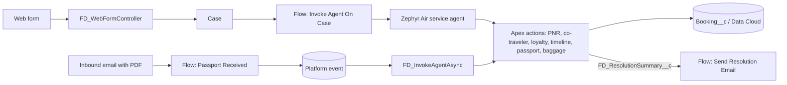

# Flight Desk

An Agentforce service-agent toolkit for an airline contact centre, for the fictional carrier *Zephyr Air*. It lets an agent look up a booking by PNR, check name-correction eligibility, read a passport scan, update the ticket, resolve baggage queries, and email the customer.

## What it does

- **Agent actions (Apex + `genAiFunctions`)** - get PNR details, find a PNR by passenger name, co-traveler details, loyalty details, departure-timeline check (name-correction eligibility window), request a passport document, parse a passport PDF (MRZ / JSON / plain text), update the PNR name, send the name-correction confirmation, and send a baggage resolution (group allowance).
- **Async agent invocation** - `FD_InvokeAgentAsync` (Queueable) runs the passport -> update -> confirm chain, and `FD_ParseAgentResponseAction` parses agent output.
- **Case intake** - `FD_WebFormController` creates a Case from a web form and links an existing Contact by email.
- **Flows** - invoke the service agent on new web Cases, resume the agent when a passport PDF arrives by email (via the `FD_PassportReceived_Event__e` platform event), and email the resolution summary.
- **LWCs** - upcoming/past itineraries, booking summary, household, loyalty card and a customer-intelligence tile (demo/mock data in several of them).

## Architecture



## Components

| Area | Items |
|---|---|
| Apex actions | `FD_GetPNRDetailsAction`, `FD_GetCoTravelerDetailsAction`, `FD_GetLoyaltyDetailsAction`, `FD_CheckDepartureTimelineAction`, `FD_RequestPassportDocumentAction`, `FD_ParsePassportPDFAction`, `FD_UpdatePNRNameAction`, `FD_SendNameCorrectionConfirmationAction`, `FD_SendBaggageResolutionAction` |
| Async / parsing | `FD_InvokeAgentAsync`, `FD_InvokeAgentAsyncAction`, `FD_ParseAgentResponseAction` |
| Web | `FD_WebFormController` |
| Flows | `FD_InvokeAgentOnCase`, `FD_PassportReceivedTrigger`, `FD_SendResolutionEmail` |
| Data | `Booking__c` (+ fields), `FD_PassportReceived_Event__e` |
| LWC | `de_Upcoming_and_Past_Itineraries`, `de_dummy_booking_summary`, `de_dummy_household`, `de_loyalty_card`, `de_fake_CI_Ent` |

## Prerequisites

- Salesforce CLI; an org with Agentforce, Service Cloud (Cases, Email-to-Case) and, for the itinerary/loyalty LWCs, Data Cloud.
- Not included and must exist in your org: the agent itself (`ZephyrAir_ServiceAgent`, referenced by `FD_InvokeAgentOnCase`), the Case fields `FD_PNRNumber__c`, `FD_IntentType__c`, `FD_ResolutionSummary__c`, `FD_PassportReceived__c`, an email template `FD_PassportRequestEmail`, and the Data Cloud objects `Zephyr_Air_Booking_Details__dlm`, `Zephyr_Air_Booking_Details_Status__dlm`, `Zephyr_Air_Loyalty_Details__dlm`.

## Setup and deploy

```bash
sf project deploy start --source-dir force-app --target-org <alias>
```

## Configuration

- Create/publish the service agent and make sure the flow's `actionName` matches it.
- Update the support contact in `FD_SendNameCorrectionConfirmationAction` (`support@zephyrair.example`, `1800-000-000` are placeholders).
- `FD_InvokeAgentAsync` falls back to a sample name when passport parsing fails; remove that for real use.

## Screenshots

Add screenshots to `docs/screenshots/`.

## License

MIT, see [LICENSE](LICENSE).
